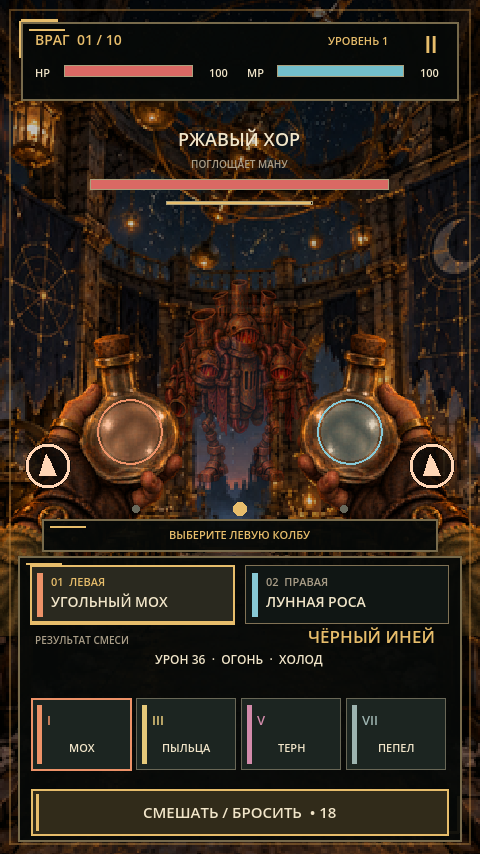
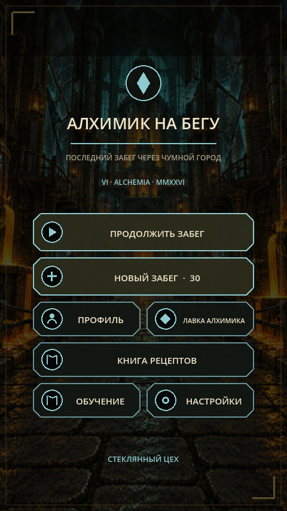
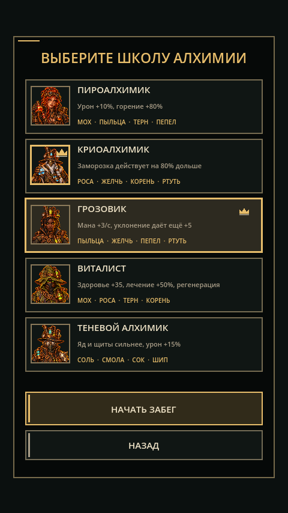
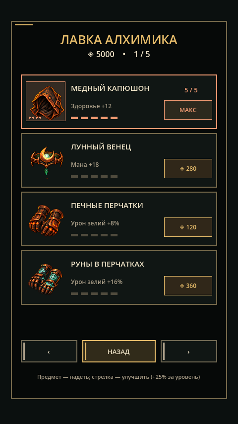

<div align="center">

# ⚗️ Алхимик на бегу

**Смешивайте зелья на ходу, уклоняйтесь от атак и пройдите башню алхимии.**

Вертикальная игра на Godot 4.7 · пять школ алхимии · короткие и длинные забеги

[Начать играть](#быстрый-старт) · [Как играть](#как-играть) · [Проверка проекта](docs/TESTING.md) · [Игровой дизайн](alchemist_run/GAME_DESIGN.md)



</div>

## Что вас ждёт

| ⚗️ Смешивание | 🏃 Забег | 🎒 Развитие |
| --- | --- | --- |
12 ингредиентов и 78 сочетаний. В каждой школе доступны четыре ингредиента и десять рецептов. | Первый забег — 10 раундов; следующие растут до 100. На маршруте встречаются обычные враги и боссы. | Пять школ, профиль до 50 уровня, лавка с 20 предметами и улучшением вещей до 5 ранга. |

Меняйте полосу, чтобы уйти из красной зоны атаки. Точное уклонение восстанавливает ману и усиливает следующий бросок. Забег сохраняется: к нему можно вернуться через «Продолжить».

## Скриншоты

<div align="center">
  
  
  
  
</div>

## Быстрый старт

1. Установите [Godot 4.7.2 Standard](https://godotengine.org/download/) — версия .NET не требуется.
2. Склонируйте репозиторий и откройте `alchemist_run/project.godot` через менеджер проектов Godot.
3. Дождитесь импорта ресурсов и нажмите **F5**. Главная сцена уже настроена.
4. В меню откройте **Обучение** или начните новый забег и выберите школу.

Проект рассчитан на портретное окно **480 × 854** и использует Compatibility renderer. Для запуска и проверки на компьютере экспортные шаблоны не нужны.

## Как играть

1. Выберите ингредиент для левой руки, затем для правой. Порядок ингредиентов на рецепт не влияет.
2. Посмотрите название, эффекты и стоимость смеси над карточками.
3. Нажмите **«Смешать / бросить»**. Для повторного броска дождитесь восстановления маны.
4. Когда враг готовит атаку, смените полосу и выйдите из подсвеченной красной зоны.
5. После босса выберите улучшение; после завершения раунда заберите награды и развивайте профиль.

| Действие | Мышь и касание | Клавиатура |
| --- | --- | --- |
| Выбрать ингредиент | Нажать карточку | `1`–`4` |
| Сменить руку | Нажать ячейку руки | `Tab` |
| Бросить смесь | Кнопка, свайп вверх или свести колбы | `Space` |
| Сменить полосу | Свайп влево или вправо | Стрелки |
| Пауза | Кнопка вверху экрана | `Esc` |

## Проверка проекта

Подробная инструкция для ручной проверки игры, сохранения, настроек и автоматических сценариев находится в [docs/TESTING.md](docs/TESTING.md). Быстрая проверка через терминал из корня репозитория:

```powershell
godot --headless --path alchemist_run --script res://tests/runner.gd
godot --headless --path alchemist_run --script res://tests/ui_runner.gd
```

Команда `godot` должна быть доступна в `PATH`; можно заменить её полным путём к исполняемому файлу Godot.

## Состояние проекта

Это игровой прототип. ПК-сценарии и автоматические проверки доступны сейчас. Мобильный экспорт, проверка удобства касаний на устройстве, баланс полных забегов и редактура дополнительных переводов остаются задачами перед выпуском.

Исходные изображения созданы для проекта с помощью OpenAI ImageGen; интерфейс и эффекты отрисованы в Godot. Подробнее об ассетах — в [описании визуального направления](alchemist_run/assets/ART_DIRECTION.md).
